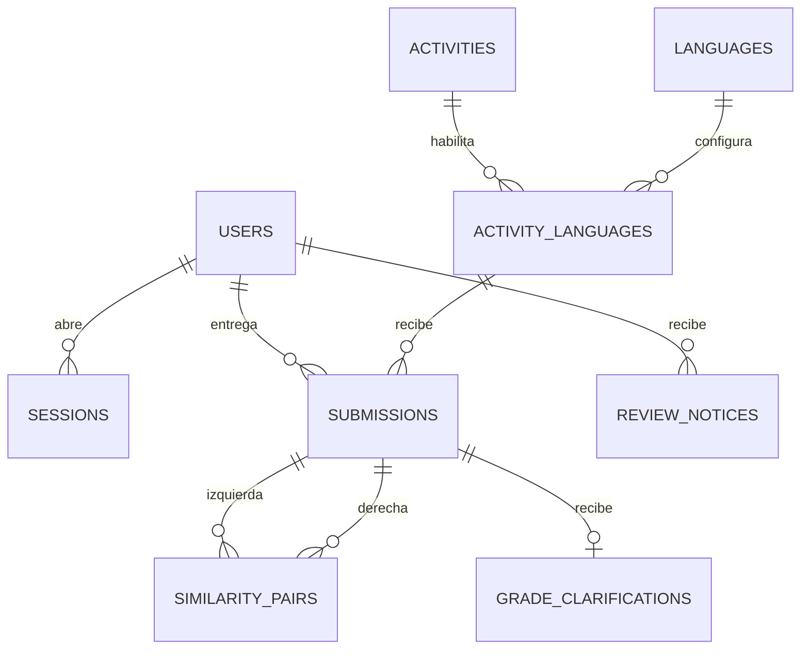

# Arquitectura de Paridad

Paridad usa **FastAPI, Jinja, PostgreSQL y Nginx**. Un proceso Python consume la cola duradera en la misma base de datos. La aplicación valida los archivos de texto y el trabajador los analiza con reglas léxicas. El motor evita compiladores, intérpretes, servicios de IA externos y acceso a red durante el análisis.

## Flujo de una entrega

```mermaid
flowchart LR
    M["Moodle · recurso URL o iframe autorizado"] --> N["Nginx · TLS"]
    B["Navegador directo"] --> N
    N --> W["FastAPI · sesión, rol y CSRF"]
    W -->|"Valida actividad, lenguaje, tamaño y texto"| Q["PostgreSQL · entrega pendiente"]
    T["Trabajador Python"] -->|"Bloquea actividad + lenguaje"| Q
    Q -->|"Original y perfil léxico"| T
    T -->|"Solo entregas completadas de otros estudiantes del mismo ámbito"| C["Comparación de tokens y rangos de líneas"]
    T --> H["Heurística de estilo e indicio de IA"]
    C --> P["Transacción · guarda pares, actualiza los dos máximos"]
    H --> P
    P --> D["PostgreSQL · resultados actualizados"]
    D -->|"Consulta por propietario"| S["Historial del estudiante"]
    D -->|"Consulta con rol ADMIN"| A["Informe docente · pares, fragmentos y señales de IA"]
    D -->|"Supera el umbral"| O["PostgreSQL · avisos privados"]
    A -->|"Envío manual"| O
    O --> S
    S -->|"Una solicitud por entrega"| R["Aclaración y respuesta docente"]
    A --> R
```

### Recálculo y concurrencia

1. FastAPI guarda el original, el crédito opcional y el estado `pending`. Una clave de idempotencia por estudiante impide que al reenviar el mismo formulario se duplique la entrega. Un bloqueo de la cuenta serializa el conteo de tres archivos incluso si sube a actividades distintas.
2. El trabajador reclama una fila de `activity_languages` con `FOR NO KEY UPDATE SKIP LOCKED`. Dos trabajadores pueden procesar ámbitos distintos simultáneamente. Cada ámbito procesa una entrega por transacción, de modo que una segunda entrega ve el resultado ya confirmado de la primera.
3. La transacción inserta un par ordenado por UUID para cada entrega previa de un **estudiante distinto** en exactamente el mismo ámbito, guarda los fragmentos y actualiza ambos máximos. Si no hay pares, el máximo de una entrega analizada es 0 %. El estado final, los pares y los máximos se confirman juntos.
4. Si la primera entrega tenía 0 % y la segunda obtiene 95 % en su comparación con ella, ambas muestran un máximo de al menos 95 %. El historial del estudiante consulta los resultados propios al cargar y se actualiza aproximadamente cada 10 segundos mientras la pestaña está visible. El foco dentro del historial pausa el refresco automático.
5. Si el proceso cae durante la transacción, PostgreSQL libera el bloqueo y conserva la entrega pendiente. Un fallo determinista revierte los cambios parciales en un punto de guardado. El trabajador reintenta con demora y tras tres fallos marca la entrega como `failed`. El administrador puede reintentar desde su informe.

Los porcentajes del motor se guardan en puntos básicos. **9500** representa **95,00 %**. Los umbrales predeterminados son **40 %** para similitud y **30 %** para indicio de IA. Una alerta usa la comparación estricta `resultado > umbral`. El umbral por actividad prevalece si se fijó y se aplica al leer el resultado, por lo que al editarlo se reevalúan las alertas del historial sin reiniciar la cola.

## Modelo PostgreSQL

| Tabla | Campos y relaciones | Índices y reglas |
|---|---|---|
| `users` | ID, usuario, nombre, correo opcional, hash Argon2id, rol y estado | Usuario y correo únicos, roles `ADMIN` y `STUDENT` |
| `sessions` | Hash SHA-256 del token aleatorio, usuario, CSRF y vencimiento | PK por hash, índices por usuario y vencimiento |
| `student_invitations` | Una invitación por estudiante, hash del token y vencimiento | El token se elimina tras su uso, revocación o vencimiento |
| `rate_limits` | Operación, IP o cuenta, inicio de ventana y contador | PK compuesta para el incremento atómico e índice de expiración |
| `settings` | Fila única con los umbrales globales | Restricciones de 0 a 100 |
| `languages` | Código, nombre, perfil, extensiones y opciones JSONB | Código único |
| `activities` | Código, título, apertura y umbrales opcionales | Código único |
| `activity_languages` | Actividad y lenguaje habilitado | PK compuesta, índice inverso por lenguaje |
| `submissions` | UUID, estudiante, ámbito, nombre, fuente, bytes originales si están disponibles, crédito, estado, intentos, versión, tokens, mapa de líneas, indicio IA, máxima similitud, rúbrica y nota docente | FK al ámbito; idempotencia por estudiante; índices para historial, cola y entregas completadas |
| `similarity_pairs` | Ámbito, dos UUID, sus propietarios, resultado, métricas y fragmentos JSONB | PK de UUID ordenados, propietarios distintos, dos FK compuestas al mismo ámbito, índice de informe y extremo derecho |
| `grade_clarifications` | Entrega, nota al solicitar, motivo, comentarios, estado y respuesta | PK por entrega, índice de solicitudes por estado y fecha |
| `review_notices` | Destinatario, entrega en avisos automáticos, causas y fecha de lectura | Índices de historial y de avisos sin leer por estudiante |
| `schema_migrations` | Nombre del SQL aplicado y fecha | PK por nombre de migración |

El código de la actividad distingue los laboratorios y puede incluir curso o grupo. Cada actividad tiene un conjunto de perfiles habilitados. El módulo de administración conserva los vínculos que ya tienen entregas. El SQL ejecutable está en [las migraciones](../migrations).

## Análisis por lenguaje

El lexer conserva cada token con su número de línea original. Separa comentarios y cadenas, descarta espacios y representa literales por tipo. Los identificadores se renombran por orden de aparición **dentro de cada ventana**. Así se conserva, por ejemplo, que un símbolo reaparezca en la misma expresión aunque se use otro nombre en la entrega comparada.

| Perfil | Reglas principales |
|---|---|
| C | Extensiones `.c` y `.h`. Comentarios `//` y `/*…*/`. Conserva operadores, tipos, preprocesador básico y palabras de control con distinción de mayúsculas. |
| Ensamblador MARIE | Extensión `.mas`. Comentario con `/`, mnemónicos e identificadores sin distinción de mayúsculas, etiquetas canónicas y fin de línea de instrucción. Conserva el selector de condición de `SKIPCOND`. |
| Ensamblador ARM | Extensiones `.s` y `.asm`. Perfil léxico para mnemónicos comunes AArch32/AArch64, registros, sufijos de condición, directivas, etiquetas y fin de línea. Reconoce comentarios `@`, `;`, `//` y `/*…*/`. Los inmediatos `#` conservan su marcador. |
| HDL Verilog / SystemVerilog | Extensiones `.v`, `.vh`, `.sv`, `.svh`. Reconoce módulos, puertos, flancos de reloj, operadores y literales dimensionados, con símbolos sensibles a mayúsculas. Ambos dialectos se agrupan en un perfil de comparación. |
| HDL VHDL | Extensiones `.vhd`, `.vhdl`. Comentarios `--`, entidades, arquitecturas, señales, procesos y tipos léxicos, sin distinción de mayúsculas. Su perfil constituye un ámbito independiente. |
| Adicional | El administrador elige extensiones, palabras clave, estilo de comentario y tratamiento de mayúsculas. Para particularidades de una gramática se añade un perfil de código y se versiona el motor. |

La versión `lexical-1` tiene alcance léxico. La semántica, la expansión de macros y las particularidades de todos los dialectos quedan fuera de esa versión. El límite es de 128 KiB de UTF-8 y 8000 tokens. Se rechazan archivos vacíos o con controles binarios.

### Similitud y fragmentos

- Se indexan los **8-gramas canónicos** en un diccionario que conserva posiciones y multiplicidades. El coeficiente Dice es `2 × gramos comunes / (gramos de A + gramos de B)`. La intersección cuenta el mínimo de apariciones para cada grama.
- Se emparejan ocurrencias por orden para acotar el costo en regiones repetitivas. Las ventanas coincidentes adyacentes con el mismo desplazamiento forman bloques. Se priorizan los bloques más largos y se descartan los que se solapan en cualquiera de las dos entregas.
- La cobertura es `2 × tokens de los bloques elegidos / (tokens de A + tokens de B)`. Se guarda `0,70 × Dice + 0,30 × cobertura`, redondeado a dos decimales porcentuales. La cobertura compara bloques incluso si cambian de posición.
- Para archivos con menos de ocho tokens se compara la secuencia canónica completa, con resultado de 0 o 100 %. El informe identifica estos casos. Un programa pequeño o una plantilla compartida puede producir similitud alta por razones legítimas.
- Cada bloque se proyecta a rangos inclusivos de líneas originales. El informe conserva hasta los 25 bloques con mayor cobertura y enlaza al código completo de cada archivo. El informe muestra los dos archivos lado a lado, resalta el rango coincidente y presenta hasta tres líneas de contexto antes y después. Los bloques largos se recorren en tramos de 60 líneas. Los rangos incluyen cualquier texto intermedio entre los tokens alineados.

El límite por defecto es de 250 entregas por combinación actividad/lenguaje. Una entrega nueva hace hasta 249 comparaciones con ese valor. Puedes ajustar el límite con `PARIDAD_SCOPE_LIMIT`. El total de pares en un ámbito crece cuadráticamente. Ajustar los límites requiere medir las colas y los tiempos con archivos representativos.

### Indicio de IA y crédito

| Señal | Peso máximo | Observación |
|---|---:|---|
| Comentarios explicativos | 28 | Líneas de comentario con cinco o más palabras, en relación con las líneas de código |
| Identificadores descriptivos | 24 | Fracción de identificadores distintos con diez o más caracteres |
| Control de flujo | 18 | Frecuencia de palabras de control por volumen de código |
| Comentarios con rótulo | 15 | Rótulos como `paso`, `ejemplo`, `param` y `return` |
| Regularidad de longitud | 15 | Dispersión relativa de la cantidad de tokens por línea en muestras de ocho líneas o más |

El total se multiplica por el mínimo entre 1, `tokens / 100` y `líneas de código / 10`. El informe conserva el valor observado y el aporte de cada señal. El valor porcentual es un **índice heurístico sin calibración probabilística**. La alerta de posible uso sin declarar requiere superar el umbral y carecer de crédito declarado. El estudiante informa la herramienta y el tipo de ayuda en el formulario. Las plantillas, la enseñanza de buenas prácticas y los estilos individuales pueden activar alertas. Las decisiones académicas requieren revisión humana y evidencia adicional.

### Nota y aclaraciones

La nota automática suma hasta 15 puntos de estructura, 10 de prácticas, 10 de comentarios en inglés y 15 de similitud. Estructura incluye consistencia de sangría, longitud de línea y organización léxica. Prácticas incluye nombres, marcas de trabajo pendiente y algunas funciones problemáticas en C. El vocabulario estimado del comentario orienta el criterio de inglés y el administrador puede corregir el resultado. Los puntos de similitud se calculan como el entero más próximo a `15 × (1 − similitud)`. El máximo de similitud puede cambiar cuando se analiza una entrega nueva o se elimina una existente, y PostgreSQL actualiza la nota automática con ese cambio. Una nota docente prevalece sobre el cálculo automático hasta que el administrador restaura la rúbrica.

## Autorización y endpoints

| Ruta | Método | Acceso |
|---|---|---|
| `/login`, `/logout` | GET/POST para entrada, POST para salida | Entrada con cuenta asignada. Los POST verifican origen y CSRF. |
| `/student` | GET | Estudiante. Actividades abiertas e historial propio. |
| `/student/submissions` | POST | Estudiante. Propietario obtenido de la sesión, combinación habilitada, idempotencia y límite de tasa. |
| `/student/submissions/{id}/nota`, `/student/submissions/{id}/aclaracion` | GET, POST | Estudiante. Nota propia y una solicitud por entrega. |
| `/student/avisos`, `/student/avisos/leer` | GET, POST | Estudiante. Bandeja propia y registro de lectura. |
| `/api/student/submissions` | GET | Estudiante. Proyección tipada de su propio historial, sin registros de pares, identidades de terceros ni fuentes. |
| `/admin`, `/admin/settings` | GET, POST respectivamente | Administrador. Panel y umbrales globales. |
| `/admin/perfil` | GET/POST | Administrador. Cambio de usuario y contraseña con confirmación de contraseña actual. |
| `/admin/accounts`, `/admin/accounts/{id}` | GET/POST, POST respectivamente | Administrador. Alta, actualización, estado, rotación de contraseña y revocación de sesiones de estudiantes. |
| `/admin/accounts/plantilla`, `/admin/accounts/importar` | GET, POST | Administrador. Plantilla e importación transaccional de Excel con descarga de contraseñas iniciales. |
| `/admin/accounts/{id}/eliminar`, `/admin/accounts/{id}/invitacion` | GET/POST, POST | Administrador. Confirmación y borrado definitivo o generación de un enlace de invitación. |
| `/invitacion` | GET/POST | Estudiante con token válido. Configuración de contraseña con un enlace de un solo uso. |
| `/admin/activities`, `/admin/activities/{id}`, `/admin/languages` | GET/POST, POST, POST | Administrador. Actividades, umbrales por actividad y perfiles configurables. |
| `/admin/reports`, `/admin/reports/{izq}/{der}` | GET | Administrador. Grupos, comparaciones y fragmentos. |
| `/admin/reports/exportar` | GET, POST | Administrador. Excel global por filtro o por selección, con similitudes, indicios y notas. |
| `/admin/avisos` | POST | Administrador. Avisos manuales a estudiantes seleccionados. |
| `/admin/aclaraciones`, `/admin/submissions/{id}/aclaracion`, `/admin/submissions/{id}/nota` | GET, POST, POST | Administrador. Listado, respuesta y ajuste de nota. |
| `/admin/submissions`, `/admin/submissions/{id}`, `/admin/submissions/{id}/descargar` | GET | Administrador. Listado de entregas, código, explicación del indicio y descarga. |
| `/admin/submissions/{id}/eliminar` | GET/POST | Administrador. Confirmación y eliminación de una entrega con recálculo de los resultados afectados. |
| `/admin/submissions/{id}/retry` | POST | Administrador. Reintento manual tras un fallo de análisis. |
| `/healthz` | GET | Sonda sin información de usuario. Comprueba acceso a PostgreSQL. |

El profesor que deba consultar informes usa el rol `ADMIN`. El alta de administradores se realiza desde la consola del servidor. La cuenta de administrador puede actualizar sus propias credenciales. Los estudiantes establecen su contraseña a través de una invitación válida o reciben las credenciales de un administrador. Las vistas y respuestas de estudiante se generan a partir de una lista explícita de campos filtrada por `student_id` de la sesión.
